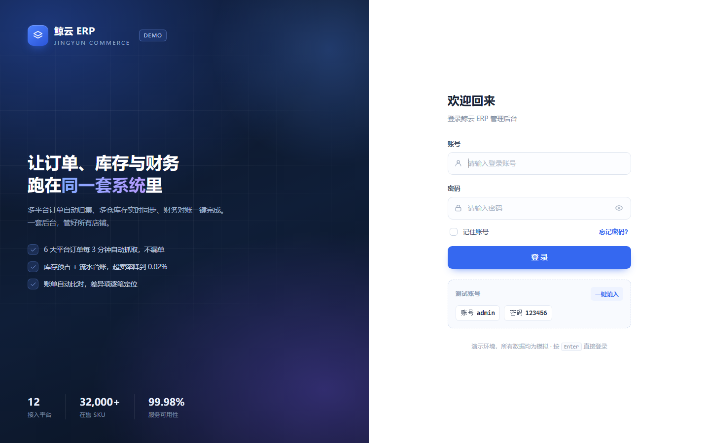
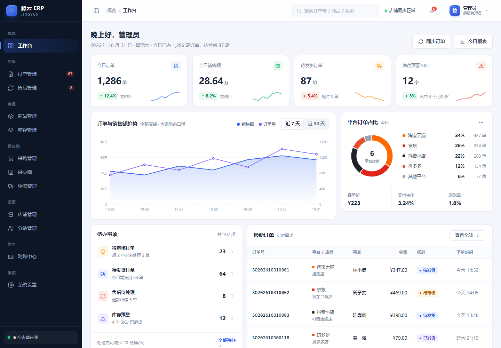

# 鲸云 ERP · 电商一体化管理后台（前端演示）

一个电商 ERP 网页端的**高保真交互演示**：纯静态页面，无需构建、无任何依赖，双击 `index.html` 或丢到任意静态托管上就能跑。

> 演示账号：`admin` ／ 密码：`123456`



## 这个演示包含什么

按电商 SaaS ERP 的标准骨架做了 **10 个可交互模块**，不是静态图：

| 模块 | 关键能力 |
| --- | --- |
| 工作台 | 今日订单/销售额/待发货/库存预警指标、7-30 天趋势图（悬停查看）、平台占比、待办、最新订单 |
| 订单管理 | 多平台订单汇总、筛选搜索、勾选后批量发货（选快递 + 打面单）、订单详情抽屉、CSV 导出 |
| 售后管理 | 仅退款/退货退款/换货/补发、处理时限预警、批量同意、售后详情（金额构成 + 进度 + 协商记录） |
| 商品管理 | SPU/SKU 双层、多规格、平台映射、新建商品表单、CSV 导入（含模板）、批量上下架 |
| 库存管理 | 多仓库存（可用/锁定/在途/安全库存）、新建调拨、盘点、库存流水 |
| 采购管理 | 按单采购、智能补货建议、多级审核、推送供应商 |
| 供应商 | 档案、账期、准时率、履约评分 |
| 物流管理 | 运单轨迹、异常预警、电子面单预览与打印 |
| 店铺管理 | 多平台授权状态、到期提醒、抓单同步 |
| 分销管理 | 分销商等级、一件代发、待结算与批量结算 |
| 对账中心 | 平台账单 vs 系统订单自动比对、差异明细、利润报表 |
| 系统设置 | 成员与角色、角色权限、操作日志 |
| 个人中心 | 资料编辑、修改密码、二次验证、登录设备管理 |



## 交互原则

演示里**没有"点了没反应"的按钮**：每个按钮要么完成一次真实的界面状态变更（发货改状态、创建商品、调拨扣减库存、对账对平），要么已经被移除。导出是真实的 CSV 下载，打印会调起浏览器打印。

## 本地运行

方式一：直接双击 `index.html`。

方式二（推荐，避免个别浏览器对本地文件的限制）：

```bash
python -m http.server 8770
# 打开 http://127.0.0.1:8770
```

## 部署

见 [DEPLOY.md](DEPLOY.md)。这是个纯静态站点，可部署到 GitHub Pages / Vercel / Netlify / 对象存储 / Nginx，无需构建步骤。

## 技术说明

- 原生 HTML + CSS + JavaScript，单文件逻辑（`assets/app.js`），零依赖、零构建
- 路由使用 hash（`#/orders`），所以**不需要服务端 rewrite 或 404 回退**，任何静态托管都能直接用
- 所有资源使用相对路径，支持部署在子目录（如 `https://name.github.io/erp-demo/`）
- 列表页由一套配置化引擎驱动（指标卡 + 筛选项 + 列定义 + 数据），新增模块只需写配置
- 数据为前端 mock：登录态与个人资料存 localStorage，业务数据在内存中，**刷新会回到初始数据**

## 数据层（真实向）

从"页面 demo"往前推了一步：库存与订单不再是一堆 UI 数字，而是有约束、可追溯的业务数据。

- **库存只有一个写入口** `_move()`：任何变动都必须落一条台账（before / after / 单据号 / 操作人）
- **订单状态机**：只允许「待审核 → 待发货 → 已发货 → 已完成 / 售后中」等合法流转，非法流转直接抛错
- **审单规则**：黑名单买家 / 地址不完整 / 大额复核 / 重复下单四条规则，全部通过才允许进入待发货
- **原子发货**：先预检（状态 + 库存），任何一条不满足就整批拒绝，不产生半成品数据
- **单据流**：出库 `CK`、调拨 `DB`、盘点 `PD`、售后退回 `TH`，单据与台账互相可追溯
- **一致性自检** `audit()`：校验每条台账 before/after 连续、期末结存与库存相等、不出现负数
- **持久化**：状态存 localStorage，刷新后发货记录、库存扣减、台账都还在；系统设置里有「重置演示数据」

### 数据层测试

不依赖浏览器，直接用 Node 跑：

```bash
node test/store.test.js
```

覆盖 23 个用例：发货扣减与出库单、台账连续性、库存不足整体回滚、状态非法拒绝、重复发货幂等、批量发货单、调拨守恒、盘点盈亏、退货入库、审单四类规则命中与分组、序列化恢复、篡改检测。

## 目录结构

```
.
├── index.html          # 入口
├── assets/
│   ├── store.js        # 领域数据层：库存台账 / 订单状态机 / 单据（可单测）
│   ├── app.js          # 页面、交互与 mock 数据
│   └── styles.css      # 设计系统与组件样式
├── test/
│   └── store.test.js   # 数据层单测（node test/store.test.js）
├── screenshots/        # 截图（README 用）
└── DEPLOY.md           # 部署说明
```

## 已知限制

- 没有后端，数据不落库；多人协作、权限校验等需要接真实接口
- 图表、打印、导出均为浏览器端实现
- 演示用账号密码写在前端，仅用于展示
